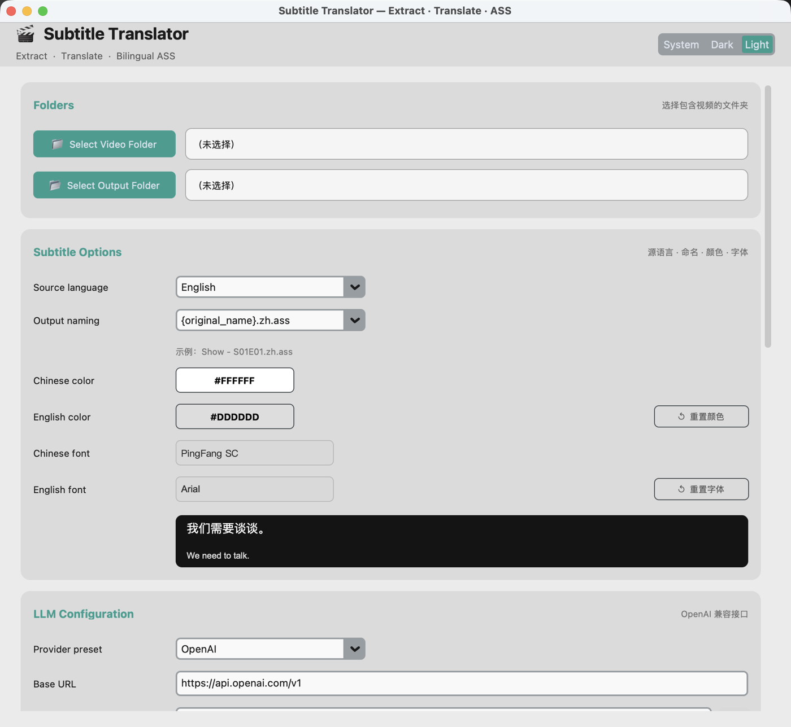
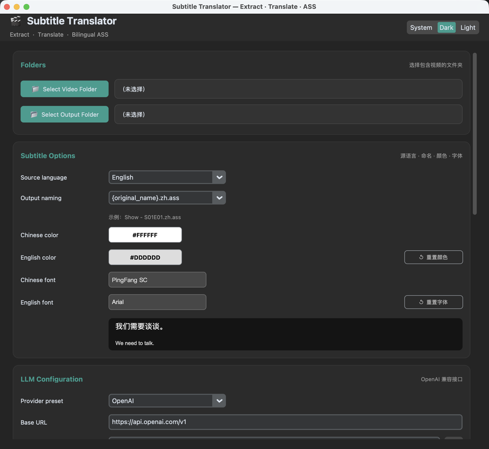

# Subtitle Translator

**把视频里的外文（软）字幕翻译成中文，生成一条中文 + 一条原文的双语 `.ass` 字幕。**
macOS 原生小工具，Python + CustomTkinter 编写，翻译走任意 OpenAI 兼容接口（OpenAI / DeepSeek / Ollama / LM Studio / llama.cpp / vLLM …）。

[](https://github.com/acesaint/subtitle-translator-x/releases/latest)
[](https://github.com/acesaint/subtitle-translator-x/releases)
[](https://www.apple.com/macos/)
[](LICENSE)

> A small, production-ready macOS app that extracts **soft subtitles** from video
> files, translates them into **Simplified Chinese** through any
> OpenAI-compatible LLM, and writes **bilingual `.ass`** files — with a clean,
> themeable GUI. See the [English quick start](#english-quick-start) at the end.



<details>
<summary>深色模式</summary>



</details>

```
视频 (mp4 / mkv / avi / mov / webm …)
   │  ffmpeg / ffprobe
   ▼
内嵌软字幕轨  ──►  临时 .srt  ──►  大模型翻译  ──►  双语 .ass
```

---

## 目录

- [功能特性](#功能特性)
- [下载与安装](#下载与安装)
- [快速上手](#快速上手)
- [字幕样式](#字幕样式)
- [翻译质量：未翻译行检测](#翻译质量未翻译行检测)
- [v1.2.0 更新日志](#v120-更新日志)
- [从源码构建](#从源码构建)
- [项目结构](#项目结构)
- [常见问题](#常见问题)
- [English quick start](#english-quick-start)

---

## 功能特性

- **现代化界面**（CustomTkinter）：深色 / 浅色 / 跟随系统，主题选择会被记住。
- **批量处理**：选一个文件夹，里面所有视频依次处理。
- **智能选轨**：可指定源语言或自动检测，只挑文本字幕轨（SRT / ASS / SSA /
  mov_text / WebVTT）；遇到图形字幕（PGS / dvb）会明确提示并跳过。
- **大模型翻译**：任何 OpenAI 兼容端点。按批发送以降低延迟与成本，时间轴永不改动。
- **双语 ASS 输出**：中文在上、原文在下（顺序可调），中英文的**颜色**和**字体**
  都能在界面里挑，带实时预览。
- **界面永不卡死**：流水线跑在后台线程，进度条 + 彩色日志实时更新。
- **配置持久化**：文件夹、API 设置、颜色、字体、主题、窗口大小都存到
  `~/.subtitle_translator.json`。
- **错误不中断**：单个文件失败只记日志并跳过，其余继续。
- **未翻译行自动补翻**：漏行、空行、原样返回的行会被识别并重新发送（详见下文）。
- **顺手的细节**：⌘O / ⇧⌘O 选文件夹、⌘R 开始、PageUp / PageDown / Home / End
  翻页、一键在 Finder 中显示输入 / 输出目录。

> **v1 范围**：只支持**软字幕**（内嵌文本轨）。硬字幕（烧进画面）不做 OCR，会提示并跳过。

---

## 下载与安装

| 你想要的 | 用哪个 | 目标 Mac 需要装什么 |
|---|---|---|
| 像普通软件一样双击就用 | `Subtitle-Translator-1.2.0.dmg` | 只需要 `ffmpeg` |
| 改代码、即时看效果 | `./setup.sh` | Python + `ffmpeg` |

### 1. 安装应用

下载 **[Subtitle-Translator-1.2.0.dmg](https://github.com/acesaint/subtitle-translator-x/releases/download/v1.2.0/Subtitle-Translator-1.2.0.dmg)**
（23 MB）→ 双击打开 → 把 **Subtitle Translator** 拖到 `Applications` → 推出磁盘映像 →
从「应用程序」启动。

<details>
<summary>校验下载完整性（可选）</summary>

```bash
shasum -a 256 ~/Downloads/Subtitle-Translator-1.2.0.dmg
# c967fedfaf9474cc57dd931807aa13ec140cacd4c6146649e0304cec87c56be7
```

</details>

**系统要求**：macOS 11 Big Sur 或更高；当前构建为 **Apple silicon (arm64)**。
Intel Mac 需要在本机用 universal2 版 Python 重新构建（见 [从源码构建](#从源码构建)）。

**安装 ffmpeg**（提取字幕必需，应用本身不含）：

```bash
brew install ffmpeg        # 没装 Homebrew 就先装 Homebrew：https://brew.sh
ffmpeg -version            # 验证
```

### 2. 第一次打开被 Gatekeeper 拦住？

应用使用 ad-hoc 签名（没有付费的 Apple 开发者证书），从网上下载后首次打开
macOS 会提示「无法验证开发者」。任选一种方式放行：

- 右键点击 App → **打开** → 再点 **打开**；或
- 终端执行一次：

```bash
xattr -dr com.apple.quarantine "/Applications/Subtitle Translator.app"
```

---

## 快速上手

1. **Select Video Folder** — 放视频的文件夹（⌘O）。
2. **Select Output Folder** — `.ass` 输出目录（⇧⌘O）。
3. **Source language** — 默认 English，可选日 / 韩 / 中 / 法 / 德 / 西 / 自动检测。
4. **LLM Configuration**
   - **Provider preset** — 选一个预设会自动填好 Base URL 与常见模型名。
   - **Base URL** — 只填到 API 根目录（形如 `.../v1`），程序会自动纠正多余后缀。
   - **API Key** — 本地服务随便填一个非空字符串即可；保存在本地配置文件中。
   - **Model** — 例如 `gpt-4o-mini`、`deepseek-chat`、`qwen2.5`。
   - **System Prompt** — 已预置一套字幕翻译提示词，可自行修改。
   - **🔌 测试连接** — 开跑前点一下，会列出服务端可用模型，URL / Key 写错立刻知道。
5. **Output naming** — 选预设或自定义模板（`{original_name}` / `{source_lang}`）。
6. **颜色 / 字体** — 中英文两行分别设置，带实时预览。
7. **Options** — 覆盖已有文件 / 保留中间 SRT / 跳过已有中文字幕的视频 / 中文在上。
8. 点 **▶ Start Processing**，看进度条与日志；**■ Cancel** 会在当前批次结束后停下。

### 常用 LLM 端点

| 服务商 | Base URL | 模型示例 |
|---|---|---|
| OpenAI | `https://api.openai.com/v1` | `gpt-4o-mini` |
| DeepSeek | `https://api.deepseek.com/v1` | `deepseek-chat` |
| Ollama | `http://localhost:11434/v1` | `qwen2.5` / `llama3` |
| LM Studio | `http://localhost:1234/v1` | 已加载的模型名 |
| llama.cpp | `http://127.0.0.1:8765/v1` | 已加载的 `.gguf` 模型名 |
| vLLM | `http://localhost:8000/v1` | 服务端模型名 |

> 本地模型示例：`llama-server -m Hy-MT2-1.8B-Q4_K_M.gguf --port 8765`，然后在应用里填
> `http://127.0.0.1:8765/v1`，Key 随便填，Model 填加载的模型名。

---

## 字幕样式

生成的 ASS 用一套手工调过的样式（经典字幕组观感）。参数都是
`src/ass_generator.py` 顶部的常量，**颜色和两个字体**可以在界面里覆盖：

| 常量 | 值 | 含义 |
|---|---|---|
| `PLAY_RES_X` / `PLAY_RES_Y` | `384` / `288` | 画布尺寸（播放器会缩放到视频分辨率） |
| `CHS_FONT` | `PingFang SC` | 中文行字体（默认，可在界面改） |
| `EN_FONT` | `Arial` | 原文行字体（默认，可在界面改） |
| `CHS_SIZE` / `EN_SIZE` | `20` / `14` | 字号（基于 384×288 画布） |
| `MARGIN_LR` / `MARGIN_V` | `10` / `10` | 左右 / 下方安全边距 |
| `CHS_OUTLINE` / `CHS_SHADOW` | `1` / `1` | 中文描边 / 阴影 |
| `CLR_CN` / `CLR_EN` | `#FFFFFF` / `#DDDDDD` | 默认文字颜色（可在界面改） |

画布只有 384×288，所以文件很小，而在 480p、1080p、4K 下看起来完全一致
（`ScaledBorderAndShadow: yes` 会一并缩放描边与阴影）。

**选颜色**：点色块打开系统调色板，色块、十六进制值和预览会立刻更新；
**↺ 重置颜色** 恢复默认。

**选字体**：点字体按钮打开字体选择器——**每一行都用自己的字体渲染**
（字体名 + `我们需要谈谈 We need to talk.` 样例），可搜索、可只筛中文字体、
双击即用、回车确认、Esc 取消。

> ASS 只记录字体**名字**，不内嵌字体。播放设备上没有该字体时会回退到系统默认字体，
> 所以想跨设备一致，请选对方也有的字体（`PingFang SC` / `Arial` 最稳）。

---

## 翻译质量：未翻译行检测

大模型偶尔会漏行，或者干脆把原文原样返回。程序不会默默把原文当译文写进去：

1. **第一遍** — 按正常批次翻译（`batch_size`，默认 40 行）。
2. **检测** — 每行都检查：缺失、空白、与原文完全相同（且原文含真实单词）、
   或完全不含中文而原文含单词，都会被标记为**未翻译**。
   （纯符号行 `...`、`♪♪`、`007` 不会被误判。）
3. **补翻** — 只把被标记的行重新发送，并加强提示词；第一次补翻把批次缩到 ≤12 行，
   第二次改成**一行一请求**，小模型在单行模式下明显更听话。
4. **兜底** — 仍然失败的行保留原文，保证字幕条数不变，并在日志里点名：

```
  -> 检测到 3 行未翻译/翻译失败，已自动补翻。
  ⚠️ 仍有 2 行未能译成中文（已保留原文），请手动检查：#12 'Huh?'; #27 'Damn it.'
```

补翻次数上限是 `max_line_retries`（默认 2），设为 `0` 可关闭。

---

## v1.2.0 更新日志

### 修复：鼠标 / 触控板无法滚动页面（重要）

**现象**：窗口里的内容比一屏高，但用触控板或鼠标滚轮怎么滑都不动，只能拖右侧滚动条。

**原因**：CustomTkinter 只监听 `<MouseWheel>` 事件。从 **Tcl/Tk 9**（现在 Python 自带
的 Tk 版本）开始，macOS 把触控板 / 妙控鼠标的**精确滚动**报成另一个事件
`<TouchpadScroll>`，`<MouseWheel>` 只留给传统的滚轮鼠标。于是笔记本上根本没有事件
被接收，页面自然不动。而 `<TouchpadScroll>` 的 `%D` 字段还把**两个**有符号 16 位
增量（x 在高位、y 在低位）打包成一个整数，单位是**像素**而不是「行」。

**修复**：新增 `src/scroll.py`，接管所有 Tk 真正会发出的事件并按像素滚动：

| 事件 | 来源 |
|---|---|
| `<TouchpadScroll>` | macOS 触控板 / 妙控鼠标（Tk ≥ 9） |
| `<MouseWheel>` | 传统滚轮、Windows、macOS 的 Tk 8.6 |
| `<Button-4/5>` | Linux / X11 滚轮 |
| `PageUp` / `PageDown` / `Home` / `End` | 键盘（焦点不在输入框时） |

顺带做对了几件事：

- **像素级**：用 `yview_moveto` 直接按像素移动，触控板的细腻增量不再被取整成「行」，
  也不额外加惯性（macOS 自己已经加过了）。
- **边界夹紧**：到顶到底就停住，不会越界。
- **滚动链**：指针在日志框或提示词框上时，先滚那个框；它到底了页面才接手——和原生应用一致。
- **互不干扰**：只响应指针所在的滚动区域，字体选择器弹窗和它背后的页面不会一起动。
- **不会双倍滚动**：先摘掉 CustomTkinter 自己挂在 `all` 上的滚轮绑定，再挂自己的。

### 其他改进

- **主题记忆**：深色 / 浅色 / 跟随系统的选择会保存，下次打开还是它（之前每次都被重置为跟随系统）。
- **窗口位置记忆**：记住上次的窗口大小与位置；若屏幕变了（例如拔掉外接显示器）会自动回落到居中，不会开在屏幕外。
- **快捷键**：⌘O 选视频文件夹、⇧⌘O 选输出文件夹、⌘R 开始处理。
- **一键定位**：Run 卡片新增「视频文件夹 / 输出文件夹」按钮，直接在 Finder 中打开。
- **日志不再抢滚动**：只有当你本来就在最底部时，新日志才会自动跟随；往上翻看历史时不会被拽回去。
- **按钮状态更清楚**：不可点击的按钮改成灰底（之前只是文字变灰，红色 Cancel 看起来仍像可点）。
- **崩溃有据可查**：打包版在 Finder 里启动时把 stdout / stderr 写入
  `~/Library/Logs/SubtitleTranslator.log`，窗口异常退出不再毫无线索。
- 选择文件夹后立即保存配置（之前要等点 Start 才写盘）。
- 版本号统一到 `src/__init__.py`，构建脚本自动读取；DMG 文件名带上版本号。

---

## 从源码构建

```bash
git clone https://github.com/acesaint/subtitle-translator-x.git
cd subtitle-translator-x

./setup.sh            # 建虚拟环境 + 装依赖 + 生成轻量 .app（开发用）
python main.py        # 或者直接跑
```

### 打包成 DMG（分发给别人）

```bash
./build_release.sh
```

产出：

```
dist/Subtitle Translator.app          # 自带 Python / Tcl/Tk / 依赖
dist/Subtitle-Translator-1.2.0.dmg    # 拖拽安装的磁盘映像
```

目标 Mac 不需要 Python、不需要虚拟环境、不需要终端。PyInstaller 按运行它的
Python 架构打包，所以默认产物是 **arm64**；Intel Mac 请在本机用 universal2
版 Python 重新构建。

想把 ffmpeg 也塞进去（目标机什么都不用装）：

```bash
./build_release.sh --bundle-ffmpeg /path/to/static/ffmpeg
```

> 必须是**静态** ffmpeg（不依赖 Homebrew 动态库），脚本会用 `otool` 检查并拒绝动态链接版本。

### 手动搭环境

```bash
brew install ffmpeg python@3.12 python-tk@3.12
python3.12 -m venv .venv && source .venv/bin/activate
pip install -r requirements.txt
python main.py
```

> ⚠️ 不要用 macOS 自带 Python（3.9 + Tk 8.5）：Tk 8.5 在新系统上画不出窗口，只会得到一片空白。
> 先确认 `python3 -c "import tkinter; print(tkinter.TkVersion)"` 输出 **8.6 或 9.x**。

---

## 项目结构

```
subtitle-translator/
├── main.py                 # 入口：Tcl/Tk 守卫、冻结模式支持、崩溃日志
├── requirements.txt
├── setup.sh                # 一键环境（venv + 轻量 .app）
├── build_app.sh            # 轻量、可移动的 .app（开发用）
├── build_release.sh        # 自包含 .app + .dmg（分发用）
├── docs/                   # 截图
├── tools/
│   ├── make_icon.sh        # 生成 .icns
│   └── make_icon.js        # 图标绘制（Cocoa bridge，无第三方依赖）
└── src/
    ├── __init__.py         # 版本号（单一来源）
    ├── config.py           # 配置读写（JSON 持久化）
    ├── scroll.py           # 滚轮 / 触控板 / 键盘滚动（Tk 9 修复）
    ├── subtitle_utils.py   # SRT 解析
    ├── extractor.py        # ffmpeg / ffprobe 提取字幕轨
    ├── translator.py       # 大模型翻译（分批、防御式解析、补翻）
    ├── ass_generator.py    # 双语 ASS 生成
    ├── fonts.py            # 已安装字体发现 + 中文字形判断
    ├── font_picker.py      # 字体选择器（每行用自己的字体预览）
    ├── processor.py        # 流水线编排（文件夹批处理）
    └── gui.py              # CustomTkinter 界面 + 后台线程
```

---

## 常见问题

- **窗口一片空白 / 全白** → 几乎一定是 **Tcl/Tk 8.5**。`python -c "import tkinter; print(tkinter.TkVersion)"`
  若是 `8.5`，用 Tk 8.6+ 的 Python 重建虚拟环境。`main.py` 现在会检测并直接说明原因。
- **滚轮 / 触控板不能滚动** → 已在 v1.2.0 修复（见 [更新日志](#v120-更新日志)）。若你改过
  `src/scroll.py` 或自建滚动区域，记得对该 `CTkScrollableFrame` 调用一次
  `install_scroll_support(frame)`。
- **找不到 ffmpeg** → `brew install ffmpeg`。应用启动时会检测并提示。
- **某个文件提示没有字幕** → 该文件没有该语言的**文本**字幕轨（或只有图形字幕），记日志并跳过。
- **每个文件都 404** → Base URL 填错了，必须停在 API 根目录（`.../v1`），不要带 `/chat/completions`。
- **API 报错** → 看日志窗口里每个文件的具体错误；限流 / 超时 / 网络错误会自动重试 2 次，
  404 / 401 这类配置错误会立即失败，不浪费时间。
- **App 一闪就没了** → 打开 `~/Library/Logs/SubtitleTranslator.log` 看最后几十行。
- **播放器不认我选的字体** → 播放器所在设备没装这个字体；ASS 只带字体名，不带字体文件。
- **配置在哪** → `~/.subtitle_translator.json`，删掉即可恢复全部默认值。

---

## English quick start

1. Download `Subtitle-Translator-1.2.0.dmg`, drag **Subtitle Translator** into
   `Applications`, and install `ffmpeg` (`brew install ffmpeg`).
2. Pick the video folder, the output folder and the source language.
3. Set **Base URL** (stop at `/v1`), **API Key** and **Model** — or click a
   provider preset — then hit **🔌 测试连接** to verify.
4. Press **▶ Start Processing**. Each video gets a bilingual `.ass` next to your
   chosen output folder; the log reports every file and any line the model failed
   to translate.

Requires macOS 11+; the shipped build is arm64. Soft (embedded text) subtitles
only — hard-subbed video is skipped with a warning.

---

## License

MIT — 随意使用、修改。
